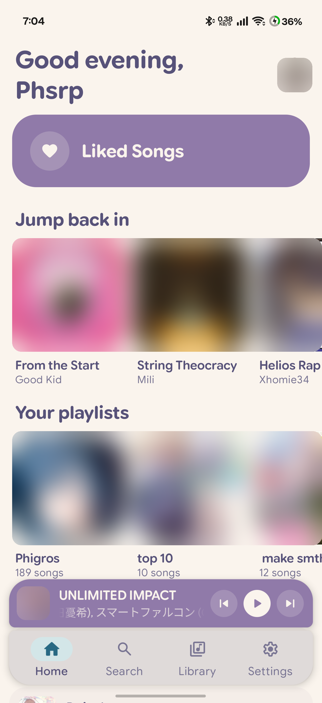
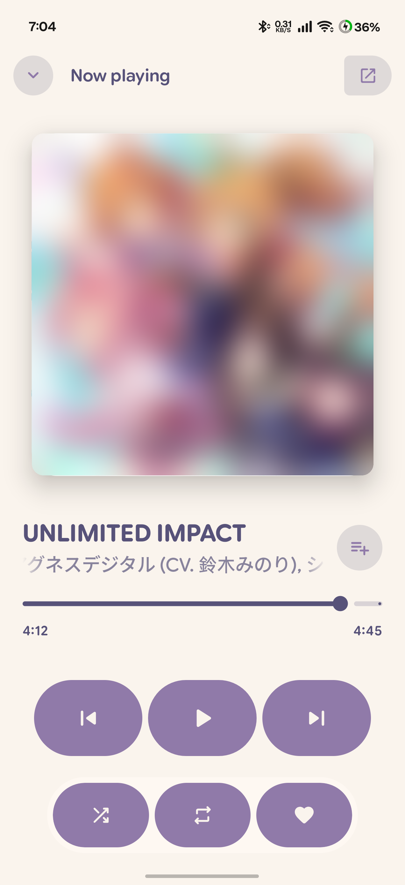
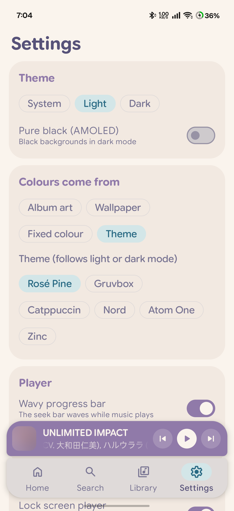

# Pixel Spot

A Material 3 Expressive remote for Spotify on Android  
**Every line of it was written by AI.**

  

  

*Album art is blurred in these screenshots.*

## Requirements

- Android 10 or newer
- The Spotify app, installed and logged in
- Spotify Premium
- Your own free app on the [Spotify developer dashboard](https://developer.spotify.com/dashboard). Pixel Spot's first screen shows what to add there.

## Credits

- Interface pieces adapted from [PixelPlayer](https://github.com/PixelPlayerHQ/PixelPlayer), from its last MIT-licensed version (commit `d51105d`)
- [Spotify App Remote SDK](https://github.com/spotify/android-sdk) (Apache-2.0) and the [Spotify Web API](https://developer.spotify.com/documentation/web-api)
- [Google Sans Flex](https://github.com/google/fonts/tree/main/ofl/googlesansflex) font (SIL Open Font License)
- [Kotlin](https://kotlinlang.org/) and [Jetpack Compose](https://developer.android.com/compose), with [Material 3 Expressive](https://m3.material.io/blog/building-with-m3-expressive) (Apache-2.0)
- [Coil](https://github.com/coil-kt/coil) (Apache-2.0) and [smooth-corner-rect-android-compose](https://github.com/racra/smooth-corner-rect-android-compose)
- [Rosé Pine](https://rosepinetheme.com/), [Gruvbox](https://github.com/morhetz/gruvbox), [Catppuccin](https://catppuccin.com/), [Nord](https://www.nordtheme.com/), Atom One and [Zinc](https://tailwindcss.com/docs/colors) colours

Pixel Spot isn't made by or affiliated with Spotify. Licence details are in [THIRD_PARTY_NOTICES.md](THIRD_PARTY_NOTICES.md), and the rest of the code is under the [MIT licence](LICENSE).
